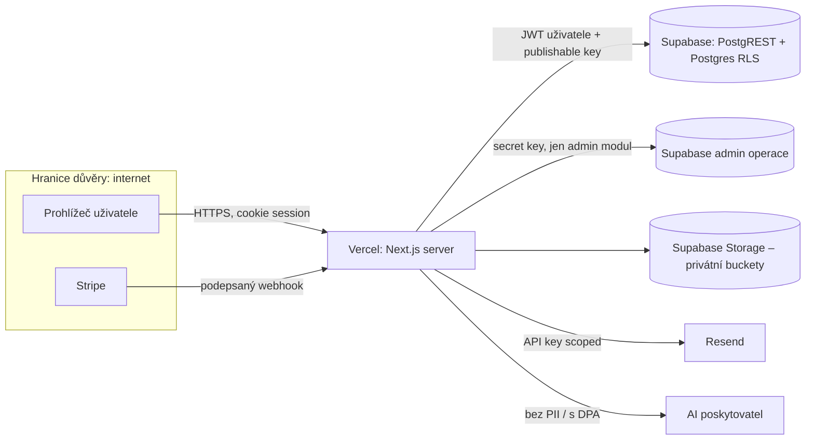

# Threat model – <projekt>

Verze: 1 · Datum: · Autor: · Revize plánována:

## 1. Architektura a hranice důvěry

## 2. Sdílená odpovědnost

| Oblast | Poskytovatel | My |
|---|---|---|
| Fyzická bezpečnost, OS, síť L3/L4 | Vercel, Supabase | – |
| RLS, GRANT, funkce, views | – | ✔ |
| Autorizace v aplikaci | – | ✔ |
| Zálohy DB | Supabase (denní/PITR dle plánu) | ověřit, testovat obnovu, offsite kopie |
| Zálohy Storage | ✘ (nezahrnuto) | ✔ vlastní |
| MFA a přístupy k účtům | – | ✔ |
| WAF pravidla, rate limit | nástroje | ✔ konfigurace |

## 3. Aktéři

| Aktér | Motivace | Výchozí přístup |
|---|---|---|
| Anonymní útočník | data, výpalné | internet |
| Uživatel jiné firmy | konkurenční info | platný účet |
| Zlomyslný zaměstnanec klienta | krádež kontaktů | role user/manager |
| Odcházející zaměstnanec | export dat | stará relace |
| Kompromitovaný npm balíček | tokeny, secrets | CI, dev stroj |
| Prompt injection | akce agenta | dokument, e-mail, hovor |
| Kompromitovaný vývojářský účet | vše | GitHub/Vercel/Supabase |

## 4. STRIDE tabulka

| ID | Komponenta | STRIDE | Hrozba | Dopad (1–5) | Pravd. (1–5) | Opatření | Ověření (test/SQL) | Stav |
|---|---|---|---|---|---|---|---|---|
| T-01 | invoices | I | IDOR – čtení faktury cizí firmy změnou ID | 5 | 4 | RLS přes membership, DAL scope | `tests/rls/invoices.test.sql` | |
| T-02 | memberships | E | Uživatel si změní roli | 5 | 3 | UPDATE politika jen owner, trigger proti self-escalation | | |
| T-03 | Stripe webhook | S | Podvržený webhook „zaplaceno“ | 5 | 3 | ověření podpisu, idempotence | | |
| T-04 | AI agent | E | Prompt injection v PDF → odeslání dat e-mailem | 5 | 3 | tool allowlist, schválení člověkem | | |

## 5. Blast radius

| Útočník získá | Dostane se k | Akceptovatelné? | Omezení |
|---|---|---|---|
| publishable key | jen to, co dovolí RLS anon | ano | |
| JWT uživatele | data jeho firmy dle role | ano | |
| secret key | celá DB | NE – minimalizovat použití | jen admin modul, rotace |
| Vercel účet | env proměnné, deploy | NE | MFA, min. členů |
| vývojářský notebook | ? | | |

## 6. Rozhodnutí sekce Y

| Opatření | Ano/Ne | Důvod |
|---|---|---|
| 4-eyes u privilegovaných operací | | |
| Aplikační šifrování | | |
| DLP / limity exportu | | |
| Oddělené admin účty | | |
| ASVS L3 části | | |
